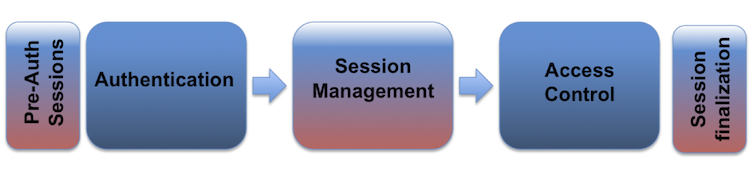

Session Management
==================

In this section we will cover the most important aspects of session management
according to OWASP's Secure Coding Practices. An example is provided along with
an overview of the rationale behind these practices.
Along with this text, there is a folder which contains the complete source code
of the program we will analyze during this section. The flow of the session
process can be seen in the following image:


When dealing with session management, the application should only recognize the
server's session management controls, and the session's creation should be done
on a trusted system. In the code example provided, our application generates a
session using JWT. This is done in the following function:

```go
// handleLogin creates a JWT and puts it in the client's cookie.
func handleLogin(logger *slog.Logger, secret []byte) http.Handler {
    ...
}
```
We must ensure that the algorithms used to generate our session identifier are
sufficiently random, to prevent session brute forcing.

**Important:** Never hardcode secrets in source code. Read them from the
environment (or a secrets manager) once at startup, and refuse to start without
them:

```go
// INSECURE - Never do this
signedToken, _ := token.SignedString([]byte("secret"))

// SECURE - Read the secret at startup and pass it to the handlers
secret := getenv("JWT_SECRET")
if secret == "" {
    return errors.New("JWT_SECRET environment variable is required")
}
...
token := jwt.NewWithClaims(jwt.SigningMethodHS256, claims)
signedToken, err := token.SignedString(secret)
if err != nil {
    // Never ignore errors from cryptographic operations.
    logger.ErrorContext(r.Context(), "signing token", "error", err)
    http.Error(w, "Internal server error", http.StatusInternalServerError)
    return
}
```

Now that we have a sufficiently strong token, we must also set the `Path`,
lifetime, `HttpOnly`, `Secure`, and `SameSite` attributes of our cookie. We
leave `Domain` unset, which limits the cookie to the exact host that set it.
In this example the cookie lives for 30 minutes, since we are considering our
application a low-risk application. `MaxAge` is used rather than `Expires`
because it is relative, so it does not depend on the client's clock.

```go
// sessionCookie returns the session cookie holding token, which the browser
// keeps for maxAge seconds.
func sessionCookie(token string, maxAge int) *http.Cookie {
    return &http.Cookie{
        Name:     cookieName,
        Value:    token,
        Path:     "/",
        MaxAge:   maxAge,
        HttpOnly: true,                    // Prevents JavaScript access (mitigates XSS)
        Secure:   true,                    // Only sent over HTTPS
        SameSite: http.SameSiteStrictMode, // CSRF protection
    }
}

http.SetCookie(w, sessionCookie(signedToken, int(sessionTimeout.Seconds())))
```

The `SameSite` attribute is critical for CSRF protection. Go supports three values:
- `http.SameSiteStrictMode` - Cookie is only sent in first-party context (recommended for auth cookies)
- `http.SameSiteLaxMode` - Cookie is sent with top-level navigations and GET requests from third-party sites
- `http.SameSiteNoneMode` - Cookie is sent in all contexts (requires `Secure: true`)

Upon sign-in, a new session is always generated. The old session is never
re-used, even if it is not expired.
We also use the `Expire` parameter to enforce periodic session termination as a
way to prevent session hijacking.
Another important aspect of cookies is to disallow a concurrent login for the
same username. This can be done by keeping a list of logged in users, and
comparing the new login username against this list. This list of active users is
usually kept in a Database.

Session identifiers should never be exposed in URL's. They should only be
located in the HTTP cookie header. An example of an undesirable practice is to
pass session identifiers as GET parameters.
Session data must also be protected from unauthorized access by other users of
the server.

Regarding HTTP to HTTPS connection changes, special care should be taken to
prevent Man-in-the-Middle (MITM) attacks that sniff and potentially hijack the
user's session. The best practice regarding this issue, is to use HTTPS in all
requests. In the following example our server is using HTTPS.

```go
srv := &http.Server{
    Addr:              *addr,
    Handler:           newServer(logger, []byte(secret)),
    ReadHeaderTimeout: readHeaderTimeout,
    ReadTimeout:       readTimeout,
    WriteTimeout:      writeTimeout,
    IdleTimeout:       idleTimeout,
}
...
srv.ListenAndServeTLS(certFile, keyFile)
```

The timeouts matter too: without them, slow clients can hold connections open
indefinitely (see [HTTP Server Security][1]).

In case of highly sensitive or critical operations, the token should be
generated per-request, instead of per-session. Always make sure the token is
sufficiently random and has a length secure enough to protect against brute
forcing.

The final aspect to consider in session management, is the **Logout**
functionality. The application should provide a way to logout from all pages
that require authentication, as well as fully terminate the associated session
and connection. In our example, logging out is a `POST` request, so other sites
cannot trigger it with a link, and it deletes the cookie from the client. The
same action should be taken in the location where we store our user session
information.

```go
// handleLogout deletes the session cookie.
func handleLogout() http.Handler {
    return http.HandlerFunc(func(w http.ResponseWriter, r *http.Request) {
        // A cookie is only replaced if Name, Path and Domain match, so build
        // it the same way as at login. A negative MaxAge deletes it.
        http.SetCookie(w, sessionCookie("", -1))
        http.Redirect(w, r, "/", http.StatusSeeOther)
    })
}
```

The full example can be found in [session.go](session.go), and its tests, which
check that forged, unsigned and expired tokens are rejected, in
[session_test.go](session_test.go).

[1]: ../communication-security/http-server-security.md
